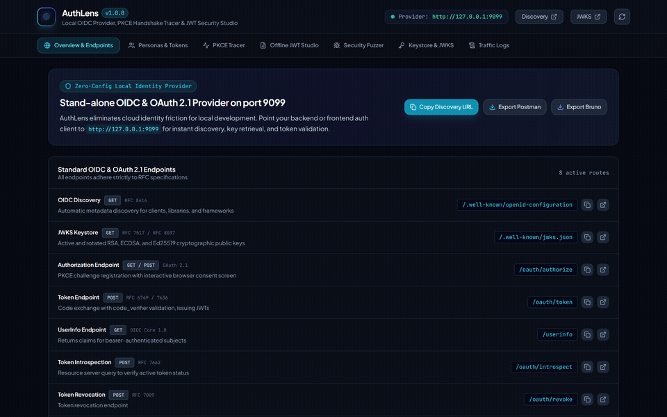
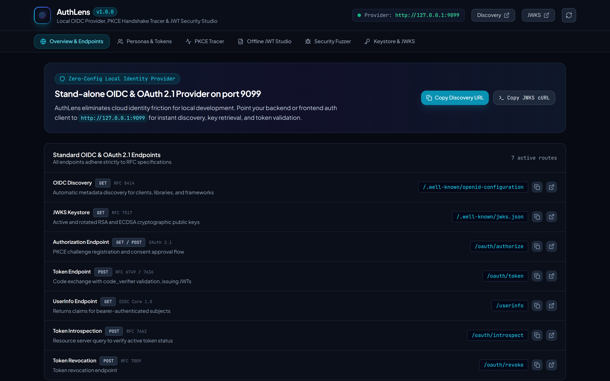
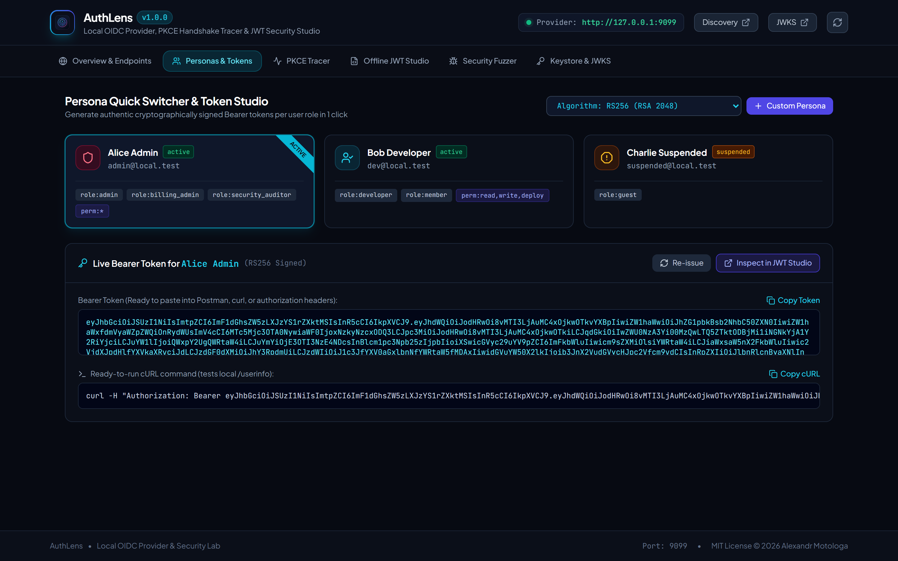
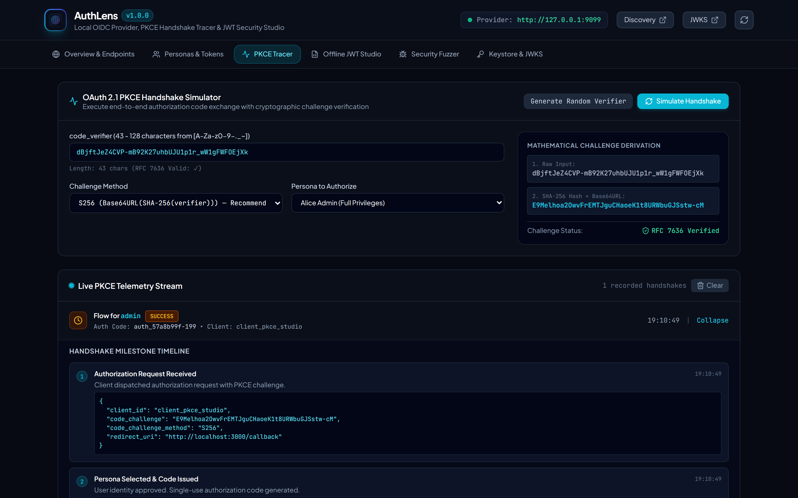
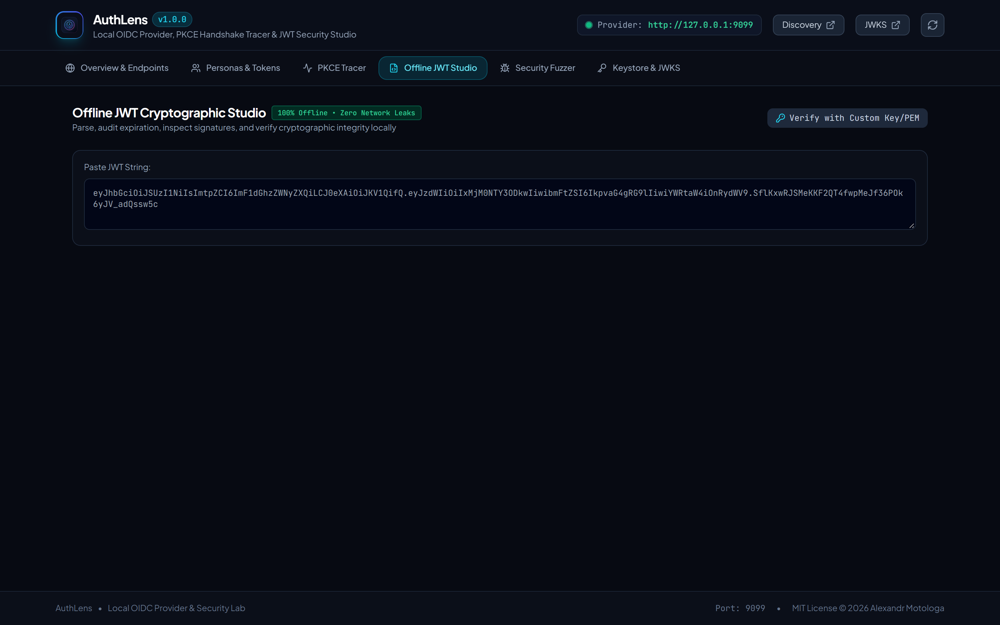
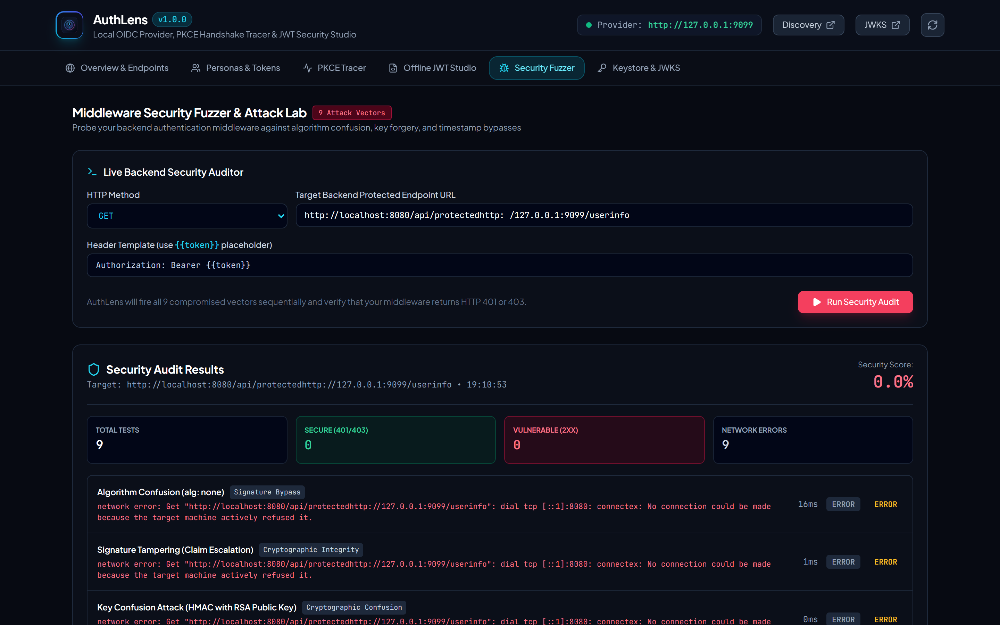
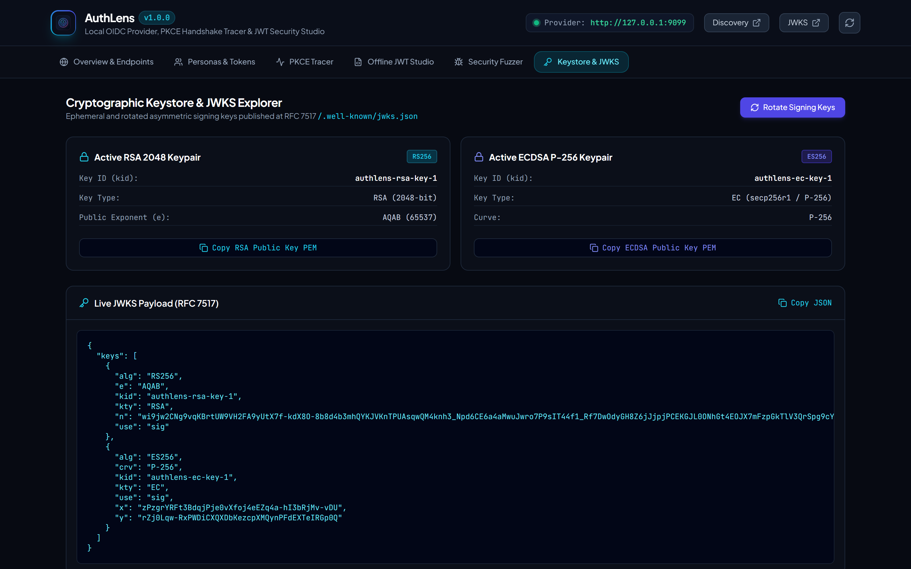

<p align="center">
  
</p>

<h1 align="center">AuthLens</h1>

<p align="center">
  <strong>Local OIDC Provider, PKCE Handshake Tracer, Offline JWT Inspector & Middleware Security Fuzzer</strong>
</p>

<p align="center">
  <a href="#quick-start">Quick Start</a> &bull;
  <a href="#core-capabilities">Capabilities</a> &bull;
  <a href="#oidc-endpoints">OIDC Endpoints</a> &bull;
  <a href="#pkce-flow-tracer">PKCE Tracer</a> &bull;
  <a href="#offline-jwt-studio">Offline JWT Studio</a> &bull;
  <a href="#security-fuzzer-lab">Security Lab</a> &bull;
  <a href="#persona-switcher">Persona Switcher</a> &bull;
  <a href="#cli-usage">CLI Usage</a> &bull;
  <a href="#architecture">Architecture</a> &bull;
  <a href="#license">License</a>
</p>

---

AuthLens is a standalone local identity provider and cryptographic token security suite. It runs directly on `127.0.0.1:9099` to eliminate developer dependency on external cloud auth providers like Auth0, Cognito, or Clerk during local development and integration testing.

It serves standard OpenID Connect (OIDC) discovery and JWKS endpoints, tracks OAuth 2.1 PKCE code exchanges in real time, parses and cryptographically validates JWT tokens completely offline without sending keys or claims to third-party websites, and generates compromised token attack vectors (`alg: none`, forged signatures, expired claims, RSA/HMAC key confusion) to verify that backend middleware correctly rejects malicious payloads.



## Screenshots

| 01. OIDC Discovery & Endpoints | 02. Personas & Token Studio |
| :---: | :---: |
|  |  |

| 03. PKCE Handshake Tracer | 04. Offline JWT Cryptographic Studio |
| :---: | :---: |
|  |  |

| 05. Security Fuzzer & Attack Lab | 06. Cryptographic Keystore & JWKS |
| :---: | :---: |
|  |  |

## Core Capabilities

### 1. Zero-Config Local OIDC Mock Provider
- Runs locally on port 9099 with RFC 8414 Discovery (`/.well-known/openid-configuration`) and RFC 7517 JWKS (`/.well-known/jwks.json`).
- Automatically generates RSA 2048 (`RS256`) and ECDSA P-256 (`ES256`) keypairs on startup.
- Supports authorization code flows with instant consent bypass or an interactive user authorization screen.
- Issues cryptographically signed ID tokens, Access tokens, and Refresh tokens matching OIDC Core 1.0 standards.
- Exposes standard `/oauth/authorize`, `/oauth/token`, `/userinfo`, `/oauth/introspect`, and `/oauth/revoke` endpoints.

### 2. Live PKCE Flow Tracer & Handshake Inspector
- Implements RFC 7636 Proof Key for Code Exchange (PKCE) with SHA-256 (`S256`) and plain code challenges.
- Records every authorization exchange step-by-step with nanosecond timestamps.
- Displays a mathematical breakdown of code challenge derivation: `code_verifier -> SHA-256 -> Base64URL -> stored code_challenge comparison`.
- Streams handshake events directly to the embedded web interface via Server-Sent Events (SSE).

### 3. 100% Offline JWT Cryptographic Studio
- Parses headers, claims, and signatures locally without transmitting bytes across any external network.
- Color-coded three-part breakdown: Red Header (algorithm, key ID), Purple Payload (claims, roles, timestamps), Cyan Signature (cryptographic bytes).
- Verifies asymmetric (RS256, RS384, RS512, ES256, ES384, ES512, EdDSA) and symmetric (HS256, HS384, HS512) signatures against local JWKS or custom public keys.
- Real-time temporal auditing: flags expired tokens, premature tokens (`nbf`), future `iat`, and calculates exact remaining time-to-live.
- Interactive token editor: modify claims in real time and re-sign with local keys using 1 click.

### 4. Middleware Security Lab & Tampering Fuzzer
- Generates 9 distinct compromised token test vectors for auditing backend authentication middleware:
  - **`alg: none` Attack**: Strips signature and sets algorithm to none to test unsecured token bypasses.
  - **Signature Tampering**: Elevates user role or permissions in the payload while retaining the original signature.
  - **Key Confusion (HMAC vs RSA)**: Signs an HMAC-SHA256 token using the server RSA public key PEM as the shared secret.
  - **Expired Token**: Issues tokens with an `exp` timestamp in the past.
  - **Premature Token (`nbf`)**: Issues tokens with a `not before` timestamp in the future.
  - **Mismatched Issuer (`iss`)**: Alters the issuer claim to test strict tenant and provider isolation.
  - **Mismatched Audience (`aud`)**: Alters the audience claim to verify resource server filtering.
  - **Unknown Key ID (`kid`)**: References non-existent keys to test error handling during JWKS key retrieval.
  - **Stripped Signature**: Removes cryptographic bytes entirely (`header.payload.`).
- Active Middleware Tester: Fires attack vectors against any local backend endpoint (`http://localhost:8080/api/...`) and checks whether all requests return HTTP 401 Unauthorized or 403 Forbidden.

### 5. Instant Persona Switcher
- Switch between simulated users with 1 click to test role-based access control (RBAC):
  - **Admin**: `admin@local.test`, role: `admin`, permissions: `["*"]`, scopes: `openid profile email admin`.
  - **Developer**: `dev@local.test`, role: `developer`, permissions: `["read", "write"]`, scopes: `openid profile email`.
  - **Suspended**: `suspended@local.test`, role: `guest`, status: `suspended`, permissions: `[]`.
  - **Custom Persona**: Define custom user IDs, tenant identifiers, and custom JSON claims.
- 1-click actions: "Copy Bearer Token", "Copy cURL Request", "Copy ID Token".

---

## OIDC Endpoints

AuthLens serves standard OIDC endpoints out of the box on port 9099:

| Endpoint | Method | RFC Specification | Description |
| :--- | :--- | :--- | :--- |
| `/.well-known/openid-configuration` | `GET` | RFC 8414 | Provider discovery metadata and capabilities |
| `/.well-known/jwks.json` | `GET` | RFC 7517 | JSON Web Key Set with active RSA and ECDSA public keys |
| `/oauth/authorize` | `GET`, `POST` | RFC 6749 / OAuth 2.1 | Authorization endpoint with PKCE challenge validation |
| `/oauth/token` | `POST` | RFC 6749 / RFC 7636 | Token exchange (`authorization_code`, `client_credentials`, `refresh_token`) |
| `/userinfo` | `GET` | OpenID Connect Core | Standard claims for authenticated subject |
| `/oauth/introspect` | `POST` | RFC 7662 | Token introspection for backend resource servers |
| `/oauth/revoke` | `POST` | RFC 7009 | Token revocation endpoint |

---

## Quick Start

### Installation

Clone the repository and build the single binary:

```bash
git clone https://github.com/alexandrmotologa/authlens.git
cd authlens

# Build frontend and binary
cd web && npm install && npm run build && cd ..
go build -o authlens ./cmd/authlens
```

### Running the Server

Start the local identity provider and management studio:

```bash
./authlens serve --port 9099
```

Open `http://127.0.0.1:9099` in your browser to access the interactive workbench.

### Generate a Quick Token from CLI

Generate a ready-to-use Bearer token for your terminal or scripts:

```bash
# Print valid admin bearer token
./authlens token --persona admin

# Print cURL command with authorization header
./authlens token --persona developer --format curl

# Verify a JWT offline in your terminal
./authlens verify eyJhbGciOiJSUzI1NiIs...
```

---

## PKCE Flow Tracer

OAuth 2.1 requires Proof Key for Code Exchange (PKCE) for all clients to prevent authorization code interception attacks.

AuthLens traces this exchange in real time:

```
+-------------------------------------------------------------------------------+
| Client Browser / App                  AuthLens (:9099)                        |
+-------------------------------------------------------------------------------+
|                                                                               |
| 1. Generate code_verifier (43-128 random chars)                               |
|    Compute code_challenge = Base64URL(SHA256(verifier))                       |
|                                                                               |
| 2. GET /oauth/authorize?                                                      |
|      client_id=my-app&                                                        |
|      redirect_uri=http://localhost:3000/callback&                             |
|      response_type=code&                                                      |
|      code_challenge=E9Mel-2Vz...&                                             |
|      code_challenge_method=S256 ----------------------------------------->    |
|                                         Stores challenge with auth_code       |
|                                 <------- Redirects with code=auth_98721       |
|                                                                               |
| 3. POST /oauth/token                                                          |
|      grant_type=authorization_code&                                           |
|      code=auth_98721&                                                         |
|      code_verifier=dBjftJeZ4C... ---------------------------------------->    |
|                                         Computes SHA-256 of verifier          |
|                                         Validates hash match                  |
|                                 <------- Returns id_token, access_token       |
+-------------------------------------------------------------------------------+
```

The web studio displays each phase of the exchange with exact timing, parameters, and verification status.

---

## Offline JWT Studio

Pasting production tokens into public web encoders risks exposing sensitive user identifiers, internal claims, and tenant IDs.

AuthLens performs all decoding, signature validation, and claims analysis strictly within your local process:
- Parses header, payload, and signature segments.
- Validates cryptographic signatures against local keys or user-supplied PEM certificates.
- Flags expired tokens, premature `nbf` values, and time drift.
- Allows editing payload JSON directly and re-signing with 1 click.

---

## Security Fuzzer Lab

Most authentication middleware bugs surface only when handling adversarial tokens. AuthLens includes a dedicated fuzzer that generates 9 test vectors and executes automated tests against your backend API:

```bash
# Test backend middleware against all 9 token tampering vectors
./authlens test --target http://localhost:8080/api/protected --header "Authorization: Bearer {{token}}"
```

Expected result: All 9 attack vectors return `401 Unauthorized` or `403 Forbidden`. If any request returns `200 OK`, AuthLens highlights the vulnerability and remediation steps.

---

## CLI Usage

```
AuthLens - Local OIDC Provider, PKCE Tracer & JWT Security Suite

Usage:
  authlens [command]

Available Commands:
  serve       Start local OIDC server and web studio on port 9099
  token       Generate instant JWT bearer token for a simulated persona
  verify      Perform offline cryptographic validation of a JWT token
  test        Execute token tampering attacks against a target backend API
  jwks        Display local JSON Web Key Set (JWKS)
  rotate      Rotate RSA and ECDSA signing keys
  help        Help about any command

Flags:
  -h, --help      Help for authlens
  -v, --version   Version information
```

---

## Architecture

AuthLens is compiled into a single binary with zero external runtime dependencies. The React 19 web studio is embedded into the Go binary using Go standard `embed.FS`.

```
authlens/
├── cmd/
│   └── authlens/
│       └── main.go               # CLI entrypoint, commands and flags
├── internal/
│   ├── oidc/
│   │   ├── keys.go               # Ephemeral & persistent RSA/ECDSA key manager
│   │   ├── discovery.go          # RFC 8414 /.well-known/openid-configuration
│   │   ├── jwks.go               # RFC 7517 /.well-known/jwks.json
│   │   ├── authorize.go          # /oauth/authorize endpoint with consent flow
│   │   ├── token.go              # /oauth/token endpoint with code exchange
│   │   ├── userinfo.go           # /userinfo endpoint
│   │   ├── introspect.go         # RFC 7662 token introspection
│   │   └── revoke.go             # RFC 7009 token revocation
│   ├── pkce/
│   │   ├── verifier.go           # RFC 7636 S256/plain challenge validator
│   │   └── trace.go              # Nanosecond telemetry & SSE event broadcaster
│   ├── jwt/
│   │   ├── decoder.go            # 100% offline header/payload/signature parser
│   │   ├── validator.go          # Cryptographic signature & temporal audit
│   │   ├── key_generator.go      # RSA 2048, ECDSA P-256, Ed25519 generator
│   │   └── signer.go             # Custom token signer
│   ├── fuzzer/
│   │   ├── tamper.go             # Attack vector mutation engine
│   │   ├── attacks.go            # alg:none, key confusion, signature tampering
│   │   └── test_runner.go        # HTTP client testing backend responses
│   ├── persona/
│   │   └── personas.go           # Simulated users (Admin, Developer, Suspended)
│   └── server/
│       ├── api.go                # REST API and SSE broadcaster for web studio
│       └── static.go             # Embedded React 19 frontend assets
└── web/                          # React 19 + Tailwind CSS + Lucide studio
```

---

## License

MIT License. Copyright (c) 2026 Alexandr Motologa.
